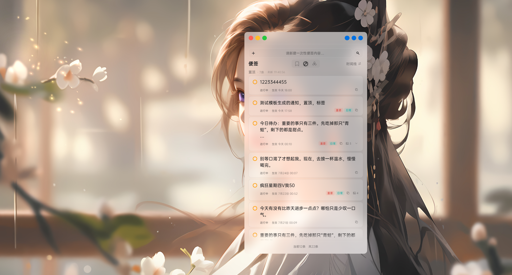
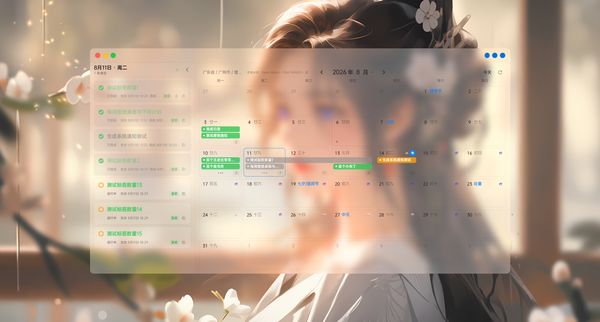
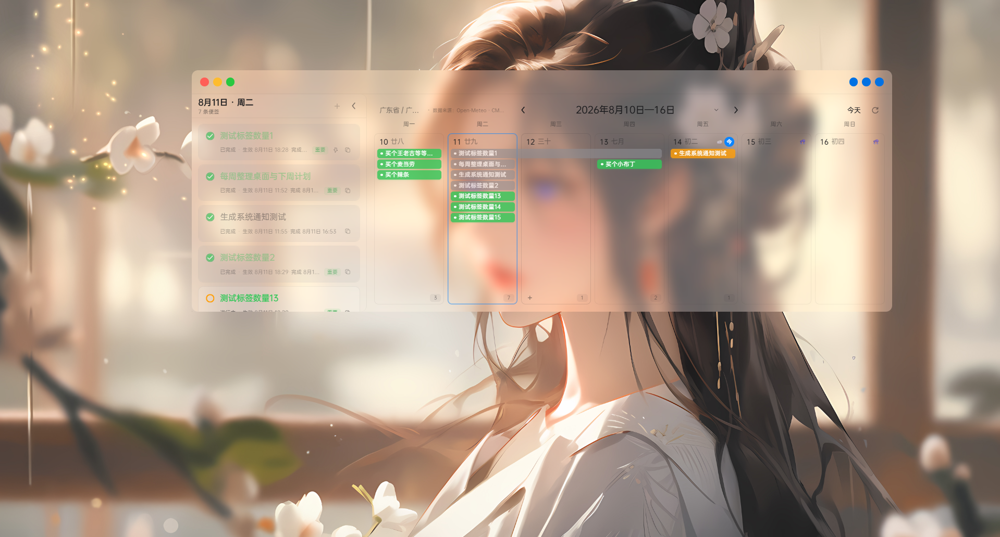
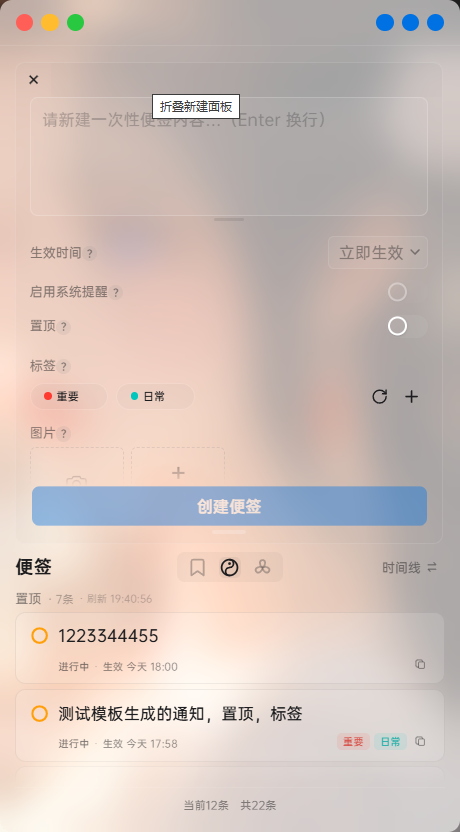
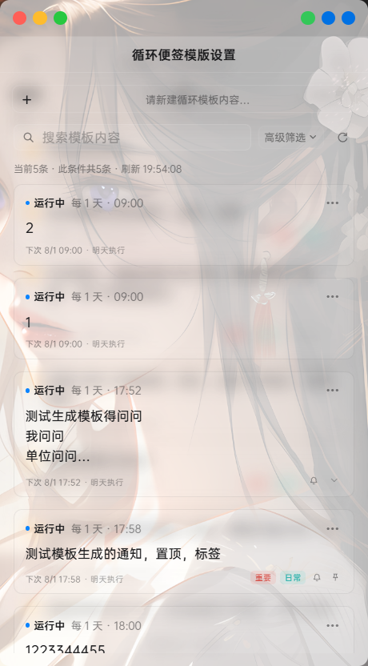
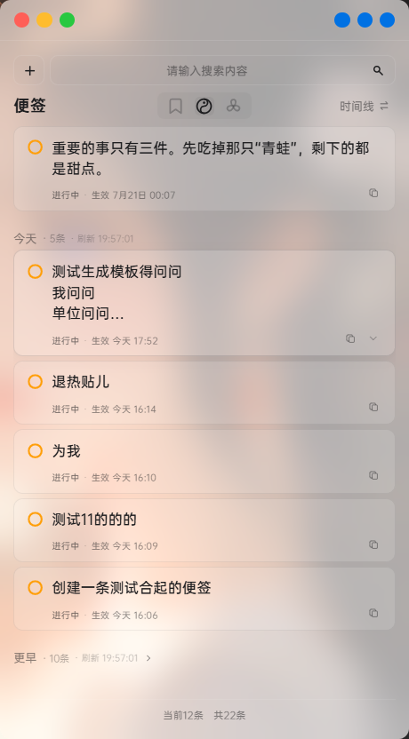
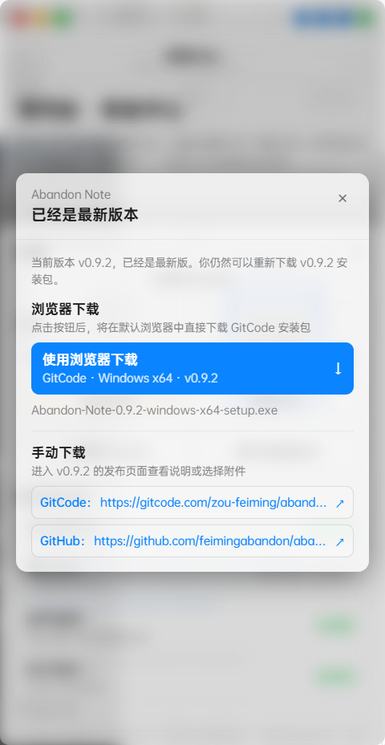
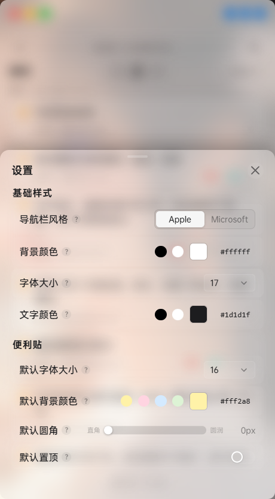
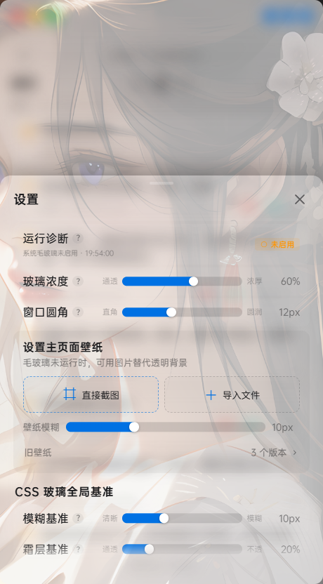

<div align="center">


# Abandon便签（Abandon Note）

**一款简洁、可靠的 Windows 桌面便签应用**

[](https://github.com/feimingabandon/abandon_note2/releases)
[](https://github.com/feimingabandon/abandon_note2/actions/workflows/ci.yml)
[](LICENSE)


支持 Windows 10 / 11（x64）

</div>

---

## 写在前言

2025 年，是一切罪恶的开始。

作者正处于失业的煎熬中，本想找个免费的便签，写点规划。谁能想到，如此简单的应用居然也能收费。于是作者一怒之下，决定自己写一个。

就这样，Abandon 便签 0.0.1 版本问世了。

过程是坎坷的，结果是稀碎的。

第一次正儿八经开发软件，作者才发现需要处理的问题远比想象中多。多屏幕、多尺寸、多缩放……一个个始料未及的问题扑面而来，以至于最初的它看上去更像一个玩具，还是一碰就碎的那种。

但是，冥冥之中似乎总有一种力量推着我继续前行。

虽然软件稀碎，可自从发布到小红书以后，却得到了很多人的喜欢。即使到了 2026 年，仍然时常有人点赞、收藏，也有很多同学认真地向我提出建议。

坦白讲，我受之有愧。

从初版问世开始，我就一直琢磨着要重构它。但懒惰与拖延的诱惑，换来了一次又一次的延期。也正因如此，很长一段时间里，我甚至不敢打开小红书，不敢面对你们的点赞和收藏。

但是没招，小红书的消息总会在不经意间出现在我的通知列表中。每一次推送，每一个点赞、收藏和评论，都像是一种特别的催稿。

人总会给自己附加上一些奇怪的使命感，仿佛自己就站在道德高地上，居高临下地怒斥这个不公、那个不对。对不对先不说，但确实挺中二的。

这么看我好歹也整上一句：

当我敲下第一行属于 Abandon 便签的代码时，我便知道——它会是这个赛道的天下第一。

过程自然不会一帆风顺，但不必多言。

我只想让你知道：

别的软件有的，它也有。

别的软件没有的，它还有。

什么月视图、周视图、列表、标签分组、循环模板便签，都是基础。

它最大的优点，是 UI，也是交互。

Windows 10 和 Windows 11 支持原生毛玻璃，可以自由调节毛玻璃样式。你喜欢的样子，它都有。

支持贴边隐藏，就像 QQ 那样。如果你担心误触，还可以开启贴边隐藏小黑条。

支持丰富的样式设置。设置页面，值得你亲自探索。

支持丰富的交互动画。让每一次点击都尽量赏心悦目。

默认采用苹果式 UI 风格，也可以切换标题栏样式。

简约不等于简单，美好应该恰如其分。

永久免费，始终开源。

当然，作者肯定也喜欢钱。只不过比起钱，更喜欢它真的被大家使用、分享和推荐。

你的推荐，我求之不得。

Abandon便签，等你来探索...

## ☕ 赞赏支持

如果 Abandon便签恰好帮到了你，可以请作者喝杯咖啡。金额不重要，0.01 也是对作者最大的肯定。

|                                                  微信赞赏                                                   |                                                    支付宝                                                     |
| :---------------------------------------------------------------------------------------------------------: | :-----------------------------------------------------------------------------------------------------------: |
|  |  |

> 赞赏完全自愿，不会解锁任何隐藏功能。不赞赏，也依然可以完整地使用 Abandon便签。

## 📖 项目介绍

Abandon便签（Abandon Note）是一款永久免费开源、以本地存储为核心的 Windows 桌面便签应用，目前支持 Windows 10 / 11。

- **三种主视图** — 通过便签列表集中整理内容，也可以在月视图和周视图中按日期安排与回顾。
- **桌面原生体验** — 支持桌面便利贴、贴边隐藏、系统提醒与 Windows 原生毛玻璃。
- **本地优先** — 便签、标签、循环模板、图片附件和壁纸保存在当前设备中，不要求登录账号，也不提供云同步。
- **持续开放** — 项目基于 GPL-3.0-only 许可证开放源码，并持续完善功能、交互与 Windows 使用体验。

如果你有想法、建议或使用反馈，欢迎提交 Issue，或发送邮件至：1160653906@qq.com。

## ✨ 功能特性

- 📝 **便签管理** — 创建、编辑、标签分类、置顶，按时间线分组浏览
- 🗓 **月历与周历** — 在月视图、周视图中查看和管理便签，支持农历、节气、节日及法定休班标记
- 🌤 **天气预报** — 在日历中展示天气图标与高低温，支持手动选择地区或按需使用设备位置
- 🔁 **循环便签** — 基于模板的周期性便签，由统一调度器自动生成，到点提醒
- 📌 **桌面便利贴** — 将便签钉在桌面，随时查看，支持多张同时展示
- 🫥 **贴边隐藏** — 窗口拖到屏幕边缘自动收起，鼠标移入触发区即滑出
- 🌫 **原生毛玻璃** — Windows 下通过 Windows.UI.Composition 实现系统级模糊背景
- 🖼 **图片与截图** — 支持粘贴图片附件、配置便签壁纸
- 🔔 **提醒通知** — 到期提醒走系统原生通知，附带应用内降级兜底
- 📄 **便签报表** — 按日期和状态筛选便签，预览后导出为 TXT 或 Excel 文件
- 📖 **帮助中心** — 内置图解式使用说明，覆盖便签、日历、便利贴和设置等主要功能
- 🔄 **更新检查** — GitCode / GitHub 双源检查公开版本，可通过浏览器直接下载 GitCode 安装包，也可进入两个平台的对应版本页面手动下载
- 💾 **本地存储** — 便签数据保存在本地 SQLite 数据库，核心便签功能无需联网

## 🖥 应用界面

**主界面** — 毛玻璃背景下的便签列表，支持置顶分组与时间线浏览



**标签分组列表** — 以标签分组整理便签，列表、月视图和周视图可随时切换

<div align="center">
  
</div>

|                       月视图                        |                       周视图                       |
| :-------------------------------------------------: | :------------------------------------------------: |
|  |  |

**桌面便利贴** — 便签钉在桌面随时查看，支持调整字号、颜色与置顶


**贴边隐藏** — 窗口拖到屏幕边缘自动收起，鼠标移入触发区即滑出


|                       新建便签                       |                         循环便签模板                          |
| :--------------------------------------------------: | :-----------------------------------------------------------: |
|  |  |

|                    时间线模式                     |                       更新检查                        |
| :-----------------------------------------------: | :---------------------------------------------------: |
|  |  |

|                     基础样式设置                     |                     毛玻璃与壁纸设置                     |
| :--------------------------------------------------: | :------------------------------------------------------: |
|  |  |

## 💽 下载安装

从以下任一官方渠道下载最新版安装包：

- [GitCode Releases（国内推荐）](https://gitcode.com/zou-feiming/abandon_note2/releases)
- [GitHub Releases（备用渠道）](https://github.com/feimingabandon/abandon_note2/releases)

### 系统要求

- Windows 10 / 11（x64）
- 仅支持 Windows 10/11 x64，不支持 Windows 7

### Windows

下载 `Abandon-Note-x.y.z-windows-x64-setup.exe`，双击运行并按提示选择安装目录。升级时可直接覆盖安装，通常不会影响已有便签；卸载程序默认也不会删除应用数据。重要资料仍建议额外备份。

> 当前安装包尚未进行数字签名，Windows 可能显示 Microsoft Defender SmartScreen 或“未知发布者”提示。请只从上方官方发布页获取安装包，并在确认发布来源无误后安装。

> 应用会检查最新公开版本。升级可直接打开下载；同版本重新下载会先确认，远程公开版本低于当前版本时会明确标记为降级并要求危险确认。下载和安装始终由浏览器与用户完成。

## 🔐 数据、隐私与联网

- 便签正文、标签、循环模板内容、图片附件和壁纸始终保存在当前设备中；应用不提供账号和云同步，也不会通过远程服务上传这些内容。
- 首次启动会发送一次匿名基础设备统计，用于估算实际启动的安装数量；这不是纯下载量，下载后从未启动的安装不会被统计。
- “接收软件通知”和“后续设备统计”默认开启，可在“设置 → 远程服务与隐私”中分别关闭。修改后的选择从下次启动起停止对应的后续请求，不会撤回首次启动已经发送的统计。
- 设备信息仅包含安装标识、应用版本、系统版本与架构、CPU、GPU、内存、语言和启动/退出时间，用于了解基础使用情况。
- 天气、更新检查、软件通知和设备信息检测需要访问网络；天气位置可手动选择，仅在用户主动选择“使用设备位置”时请求定位并将坐标转换为地区名称。

重要内容不要只保存一份。遇到问题时，可以在设置中查看或导出运行日志，并通过 Issue 或邮件反馈。

## ⌨️ 本地开发

### 环境要求

- Node.js 22（项目使用 [Volta](https://volta.sh/) 锁定版本）
- Windows 下编译原生毛玻璃模块需要 Visual Studio C++ 构建工具与 CMake

### 克隆与安装依赖

```bash
git clone https://github.com/feimingabandon/abandon_note2.git
cd abandon_note2
npm ci
```

### 开发模式

```bash
npm run dev
```

### 测试与检查

```bash
npm run lint       # ESLint 检查
npm run test:unit -- tests/test-selection.test.js       # 具体登记单元文件
npm test -- --file tests/test-selection.test.js --plan  # 只读查看局部范围
npm test -- --file tests/test-selection.test.js         # 执行该文件及必需前置
npm run build      # 完整生产构建
git diff --check   # 检查空白字符错误
```

`npm test`、`test:unit`、`test:db` 及窗口/原生选择入口的空参数会拒绝执行，未知选择也不会回退全量。数据库使用 `npm run test:db -- --file tests/note-duration-db.mjs --plan`，具体窗口使用 `node scripts/run-electron-window-tests.cjs --file tests/daily-report-electron.mjs --plan`。`--plan` 不启动测试或构建；缺少结果适配、平台或构建来源证明时，执行结果会明确阻断，不将退出码 0 等同于业务通过。

普通 CI 按明确的提交差异及已验收叶模块规则选择具体单元/平台专项；源码import和文本读取关系只提示候选，不自动扩大范围。主入口/公共schema/native等跨域或未映射改动要求明确补充校验范围，文档变更和无变更分别说明无需测试的原因。显式全量使用 `npm run test:full:win`，发布工作流使用独立 `test:release:quality`，均不能当作日常默认入口。构建复用、精确 Qt 选择及证据读取见 [测试入口说明](docs/testing/README.md)。

界面、主题和组件样式改动请遵守 [UI 材质与边线开发标准](docs/UI_DESIGN_STANDARD.md)。

### 构建打包

```bash
npm run build:unpack:win # Windows：生成未封装目录，便于本地运行验证
npm run build:win        # Windows：先编译原生毛玻璃模块，再打 NSIS x64 安装包
```

## 🛠 技术栈

| 层       | 技术                                                                           |
| -------- | ------------------------------------------------------------------------------ |
| 桌面框架 | [Electron](https://www.electronjs.org/) 43                                     |
| 前端     | [Vue 3](https://vuejs.org/) + [electron-vite](https://electron-vite.org/)      |
| 数据存储 | [better-sqlite3](https://github.com/WiseLibs/better-sqlite3)（本地 SQLite）    |
| 日历数据 | [chinese-days](https://github.com/vsme/chinese-days)（农历、节气与中国节假日） |
| 天气服务 | [Open-Meteo](https://open-meteo.com/)（预报与地理编码 API）                    |
| 原生能力 | C++（Windows.UI.Composition 毛玻璃）+ [koffi](https://koffi.dev/) FFI 桥接     |
| 打包     | [electron-builder](https://www.electron.build/)                                |

## 💐 感谢与致谢

Abandon便签的天气、定位与日历能力离不开以下开源项目和开放 API，在此向它们的维护者与服务提供方表示感谢：

- [Open-Meteo](https://open-meteo.com/) — 提供天气预报与地理编码 API；中国地区优先使用其接入的 CMA GRAPES 预报模型。
- [BigDataCloud](https://www.bigdatacloud.com/) — 提供反向地理编码 API，仅在用户主动选择“使用设备位置”时用于将坐标转换为地区名称。
- [chinese-days](https://github.com/vsme/chinese-days) — 提供农历、二十四节气、中国法定节假日、调休与工作日数据。
- [@aurouscia/china-areas](https://gitee.com/au114514/au-npm-pkgs/tree/master/packages/china-areas) — 提供本地中国行政区划数据，用于手动选择天气地区。

### 测试与反馈

感谢所有参与测试、反馈问题并帮助改进 Abandon便签的朋友。

欢迎加入“便签测试群”，参与新版本测试、反馈问题和交流使用体验。二维码如已失效，可通过 Issue 或邮件联系作者获取新的入群方式。

<div align="center">
  
</div>

## 🤝 参与贡献

欢迎提交 [Issue](https://github.com/feimingabandon/abandon_note2/issues) 反馈问题或建议；提交 PR 前运行直接相关的明确局部测试、必要构建、`npm run lint` 与 `git diff --check`，并说明实际验证范围和未覆盖部分。

## 📜 许可证

本项目基于 [GNU GPL v3](LICENSE)（`GPL-3.0-only`）开源。

## 📋 更新日志

### Abandon Note 1.4.0

重构解耦全部代码，保证代码职责分明。

#### 新增

1. 新增完整截图/贴图完整功能，可使用快捷键 F1 或者自行设置进行截图。截取的图片除基础功能外，可直接作为截图便签素材使用。
2. 新增万年历。
3. 系统通知新增托盘闪烁、内部弹窗、再次提醒功能。
4. 截图增加快速复制快捷键，默认是 Ctrl + F1。
5. 周/月视图的今天日期格子暂定为红色边框。
6. 周/月视图增加未完成移动到今天的功能，且只能将“仅今日”的便签移动到今天。
7. 周/月视图增加“快捷新建默认持续到完成”开关。开启后，日期格子快捷创建的便签将会默认为持续到已完成，入口位于“便签延续与移动”弹窗。
8. 新建便签可增加备注。
9. 日报导出中增加标签条件查询，导出列表中增加标签列。

#### 修改

1. 完善层级设置，增加稳定性。
2. 完善日志系统，增加深度收集按钮。
3. 完善天气功能。
4. 完善多弹窗执行顺序。
5. 新建便签后保留已设置的选项信息。
6. 改变基础布局规则，缩放宽高时，布局内组件大小不再同步缩放，改为在设置页面选择界面缩放。
7. 截图与显示隐藏窗口的默认快捷键分别为 F1 和 F2。
8. 重写新建与修改便签的底层逻辑，不再默认创建时的便签状态。以生效时间为基础，联动设置状态（初始化、进行中、已完成）、提醒方式。
9. 便签列表的新建面板不再自动收起。
10. 天气和宜忌的组件统一，同时增加开关来显示与隐藏。

#### 1.5.0 预告

下个版本将以 UI 与交互为准，力求大幅改善。因此下一个更新节奏可能会到下个月，至少是中旬，视情况而定。

### Abandon Note 1.3.0

本次更新重点调整便签的持续方式，丰富正文与图片的展示，并改进窗口交互和本地诊断。

#### 便签与日历

- 新增便签备注，可在快速编辑中分别修改正文和备注，并单独调整备注字号。
- 支持为正文中的选中文字设置颜色；颜色会显示在便签卡片、搜索结果及月、周视图中。
- 新增“标签颜色”开关，控制有标签便签的正文和日历横条是否使用标签颜色。
- 支持创建只有图片、没有正文的便签；卡片可轮播图片，月、周视图也可打开图片并前后切换。
- 持续方式改为“仅当天、指定天数、持续到完成”。持续到完成的便签会在日历中延续，完成后固定结束日期；报表会显示相应持续信息。
- 移除旧的“历史未完成便签移至今天”和“自动移至今天”功能，改用新的持续方式。旧便签不会因升级自动变成“持续到完成”。
- 日历的当日便签预览可直接执行提前开始、标记完成或重新进行；月、周工具栏也调整了天气和循环便签预览入口。
- 循环模板可设置开始时间和可选结束时间，仅在有效期内生成便签。

#### 窗口与设置

- 重做主视图与灵动岛的切换和原生毛玻璃动画；重新启动或从托盘打开时进入完整主视图，不再跨启动保存灵动岛状态。
- 改进窗口拖动、贴边隐藏、层级切换及恢复过程中的状态同步。
- 新增“截图时隐藏主视图”开关，可选择是否将应用窗口截入图片，并改进截图窗口异常退出后的恢复。
- “恢复默认设置”现在也会恢复图标、天气、远程与隐私等全局共享设置；确认窗口会说明影响范围。

#### 诊断与帮助

- 日志支持导出最近一小时或全部记录；新增操作关联和保存结果记录，便于定位便签、设置及窗口问题。
- 修复帮助中心快捷入口，使其指向当前仍存在的功能说明。

### Abandon Note 1.2.0

当前版本修改颇多，本想着再打磨一阵。但由于其中若干改进建议被反复提及，因此决定提前发布。若使用过程中遇到问题，可发送邮件至 1160653906@qq.com，或加入便签测试群反馈。Windows 10 用户使用灵动岛时可能遇到小问题，双击缩放过程中偶尔会出现闪烁，目前仍在排查。最后，感谢使用！

本次版本新增多项便签管理、日历交互与窗口能力，并重点加强数据保护和 Windows 原生交互稳定性。

#### 主要更新

- 新增灵动岛模式，支持双击收起或展开、长按拖动、位置记忆及便签状态操作。
- 新增始终置底模式，可在“始终置顶、普通窗口、始终置底”之间切换。
- 三种主视图统一新增视图切换入口，并支持全局快捷键显示或隐藏当前窗口。
- 新增历史便签补录，可直接为过去日期创建便签。
- 新增历史未完成便签移至今天，支持昨天、最近三天、全部历史、自定义范围及逐条选择。
- 新增“自动移至今天”，可每天自动移动昨天未完成的普通单日便签。
- 列表、月视图和周视图支持双击快速编辑正文，桌面便利贴也可直接编辑。
- 新增未保存草稿保护和编辑冲突处理，切换视图或退出时不再轻易丢失正在编辑的内容。
- 已删除便签现在可以通过搜索结果恢复，并保留正文、标签和图片。
- 循环模板新增自然季度规则、未来生成预览，以及错过当天生成时间后的启动补生成。
- 月视图升级为完整的六行日历，并新增日期右键菜单、当日便签预览和日期格快速创建。
- 月、周日期列表改为独立开关，支持拖动调整宽度，并分别记忆两个视图的宽度。
- 新增便签报表导出，支持最长 366 天范围以及 TXT、Excel 格式。
- 优化天气定位和城市选择，便签列表、月视图及周视图均可显示对应日期的天气。
- 新增导航栏图标大小和黑白颜色设置，并支持主窗口内侧边框及更大的日历字体。
- 软件通知和更新说明支持 Markdown、表格、代码、链接及 HTTPS 图片。
- 帮助中心新增分类导航和内容搜索，并补充本版本新增功能的使用说明。

#### 体验与稳定性优化

- 优化灵动岛收起与展开、毛玻璃恢复、窗口显示和多显示器缩放切换。
- 加强贴边隐藏、触边确认、全屏检测和窗口层级恢复。
- 优化月、周视图切换、刷新、便签增删、排序及日期侧栏动画。
- 加强桌面便利贴的正文同步、状态恢复和异常退出恢复。
- 优化中文输入法、下拉面板、标签选择器、键盘操作和焦点恢复。
- 优化大量便签、附件和图片缩略图的加载性能。
- 完善异常恢复机制，窗口崩溃或核心任务失败时提供重载、重试和诊断入口。
- 加强诊断日志，记录窗口位置、显示器、DPI、缩放比例、毛玻璃和贴边状态等信息。
